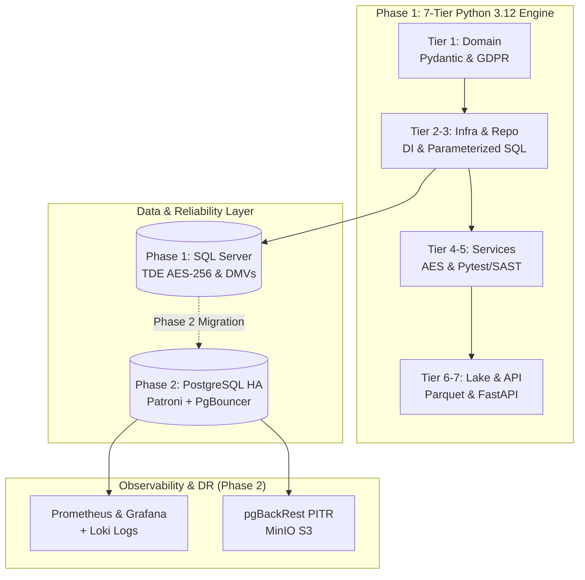

# ClinicEnterprise-DevSecOps

> **Project Status:** `Active Development (Phase 1 — Core Pipeline)`  
> An end-to-end **Database Reliability Engineering (DBRE)** and **Secure Data Engineering Platform** blueprint, transitioning a Python extraction engine into a 7-tier, DevSecOps-hardened, and highly available data ecosystem.

## 1. Executive Overview
**ClinicEnterprise** is a personal enterprise-grade engineering platform designed to demonstrate defense-in-depth security, clean Object-Oriented architecture, and production database reliability across two structured phases:
- **Phase 1 (Current — Nov 2026):** 7-Tier Python 3.12 OOP Data Pipeline on SQL Server with Pydantic validation, GDPR PII masking, Dependency Injection, parameterized repositories, AES envelope encryption, Parquet ingestion, and a FastAPI DBRE control plane.
- **Phase 2 (Planned — Dec 2026 – Jan 2027):** Migration to Linux-native **PostgreSQL 16/17 High Availability** (3-node Patroni cluster, HAProxy, PgBouncer), Point-in-Time Recovery (`pgBackRest` + MinIO S3), and full observability (`Prometheus`, `Grafana`, `Loki`).

## 2. Target Architecture

## 3. Implementation Roadmap & Progress

### Phase 1: 7-Tier Core Python Pipeline (SQL Server)
- [x] **Tier 1 — Domain Models:** `Patient`, `Doctor`, `Appointment`, and `Invoice` Pydantic models with strict type boundaries, Object Composition, and GDPR PII masking.
- [x] **Tier 2 — Infrastructure:** Context-managed database connection lifecycle and `.env` credential isolation.
- [x] **Tier 3 — Repositories:** `PatientRepository`, `DoctorRepository`, `AppointmentRepository`, and `DatabaseHealthRepository` (SQL Server DMVs) using Dependency Injection and parameterized queries (`?`).
- [x] **MVP Runner:** End-to-end extraction pipeline (`main.py`) — *refactoring `print()` to structured `logging`*.
- [ ] **Tier 4 — Services & Security (Next):** `ClinicService` business rules, GDPR-safe structured logging, and Application-Level AES envelope encryption.
- [ ] **Tier 5 — Automated Testing & SAST:** `pytest` unit test suite with mock repositories + `Semgrep` static security scanning.
- [ ] **Tier 6 — Data Engineering Ingestion:** Partitioned `.parquet` export (`Pandas`/`PyArrow`) and external API client with TLS verification.
- [ ] **Tier 7 — DBRE Control Plane:** Headless `FastAPI` service (`GET /dbre/health`, `POST /de/trigger-parquet-export`) secured via `X-API-Key`.
- [ ] **Storage Encryption:** SQL Server Transparent Data Encryption (TDE / AES-256 at rest).

### Phase 2: Linux & PostgreSQL HA Architecture
- [ ] **Linux Migration:** Full execution migration to Ubuntu Linux (WSL2) with hardened file permissions (`chmod 600 .env`).
- [ ] **PostgreSQL HA Cluster:** PostgreSQL 16/17 + 3-node **Patroni** cluster + **HAProxy** + **PgBouncer** transaction pooling.
- [ ] **Disaster Recovery:** Automated Point-in-Time Recovery (PITR) using **pgBackRest** to local **MinIO (S3)**.
- [ ] **Observability & Network Security:** **Prometheus/Grafana/Loki** telemetry stack + mandatory **SSL/TLS** and **SCRAM-SHA-256** in `pg_hba.conf`.

## 4. Core Tech Stack
- **Backend & Data:** Python 3.12, Pydantic, FastAPI, Pandas, PyArrow (Parquet), pyodbc / psycopg3
- **Databases & HA:** SQL Server (DMVs, TDE), PostgreSQL 16/17, Patroni, HAProxy, PgBouncer
- **DevSecOps & DR:** GDPR PII Masking, AES Encryption, Semgrep (SAST), Pytest, pgBackRest, MinIO (S3)
- **Observability:** Prometheus, Grafana, Promtail / Loki
