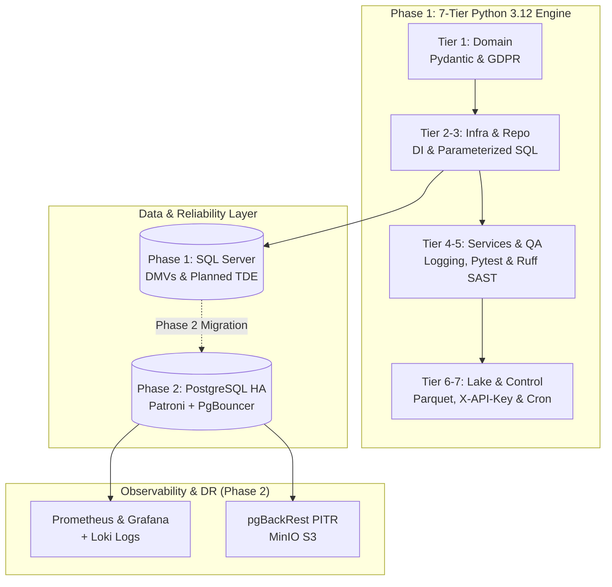

# ClinicEnterprise-DevSecOps


> **Project Status:** `Active Development (Phase 1 — Core Pipeline, Ingestion & DBRE Control Plane Live)`  
> An end-to-end **Database Reliability Engineering (DBRE)** and **Secure Data Engineering Platform** blueprint, transitioning a Python extraction engine into a 7-tier, DevSecOps-hardened, and highly available data ecosystem.

---

## 1. Executive Overview
**ClinicEnterprise** is a personal enterprise-grade engineering platform demonstrating clean Object-Oriented architecture, defense-in-depth data security, and production database reliability across two structured phases:
- **Phase 1 (Current — Nov 2026):** 7-Tier Python 3.12 OOP Data Pipeline on SQL Server with Pydantic boundary validation, GDPR PII masking, Dependency Injection, parameterized repositories, structured logging, automated `pytest` & `Ruff` SAST gates, Parquet ingestion modules, and a hardened `FastAPI` DBRE control plane (`X-API-Key` auth, `chmod 600` secret isolation, and headless WSL2 Linux `cron` scheduling), with SQL Server TDE and AES envelope encryption hardening next.
- **Phase 2 (Planned — Dec 2026 – Jan 2027):** Migration to Linux-native **PostgreSQL 16/17 High Availability** (3-node Patroni cluster, HAProxy, PgBouncer), Point-in-Time Recovery (`pgBackRest` + MinIO S3), and full observability (`Prometheus`, `Grafana`, `Loki`).

> **Architecture Documentation:** Full design references are available in [`docs/HLD.md`](docs/HLD.md) and [`docs/FullApplicationFlow.md`](docs/FullApplicationFlow.md).

---

## 2. Target Architecture



---

## 3. Repository Structure

```text
ClinicEnterprise-DevSecOps/
├── .github/
│   └── workflows/
│       └── ci.yml                             # Automated GitHub Actions pytest CI pipeline
├── api/
│   ├── main.py                                # FastAPI app, DI factory & DBRE/DE endpoints
│   └── security.py                            # X-API-Key auth using secrets.compare_digest()
├── docs/
│   ├── HLD.md                                 # High-Level Design blueprint
│   └── FullApplicationFlow.md                 # End-to-end execution flow documentation
├── infrastructure/
│   └── database.py                            # SQL Server connection lifecycle via pyodbc & env config
├── ingestion/
│   ├── appointment_parquet_exporter.py        # Partitioned Parquet export & PII hashing
│   └── external_doctor_api_client.py          # Hardened external doctor API ingestion client
├── models/
│   ├── patient.py                             # Pydantic domain model & masked_phone() PII protection
│   ├── doctor.py                              # Doctor domain model & active-status validation
│   ├── appointment.py                         # Appointment domain model & object composition
│   └── invoice.py                             # Invoice domain model & boundary rules
├── repositories/
│   ├── patient_repository.py                  # Parameterized queries (?) & DI
│   ├── doctor_repository.py                   # Doctor data access
│   ├── appointment_repository.py              # Relational joins & incremental extraction
│   └── database_health_repository.py          # SQL Server DMV health telemetry queries
├── services/
│   └── clinic_service.py                      # Business rules, DI coordination & GDPR-safe logging
├── tests/
│   ├── test_clinic_service.py                 # Service unit tests (MagicMock & caplog PII leak checks)
│   ├── test_api.py                            # FastAPI TestClient endpoint & auth tests
│   ├── test_appointment_parquet_exporter.py   # Parquet exporter unit tests
│   └── test_external_doctor_api_client.py     # External API client unit tests
├── main.py                                    # CLI pipeline runner
├── .env.example                               # Safe environment variable template
├── .gitignore                                 # Excludes .env, virtual envs, caches & scratch artifacts
├── requirements.txt                           # Project runtime & test dependencies
└── README.md
```

---

## 4. Implementation Roadmap & Progress

### Phase 1: 7-Tier Core Python Pipeline (SQL Server)
- [x] **Tier 1 — Domain Models:** `Patient`, `Doctor`, `Appointment`, and `Invoice` Pydantic models with strict boundary validation, Object Composition, and `masked_phone()` PII protection.
- [x] **Tier 2 — Infrastructure:** SQL Server connectivity via `pyodbc` and `.env` credential isolation (enforced via `.gitignore` and `.env.example`).
- [x] **Tier 3 — Repositories:** `PatientRepository`, `DoctorRepository`, `AppointmentRepository`, and `DatabaseHealthRepository` (SQL Server DMVs) using Dependency Injection and 100% parameterized queries (`?`).
- [x] **Tier 4 — Services & Security:** `ClinicService` business rules and GDPR-safe structured `logging` (verified zero PII leakage in `caplog` tests); AES envelope encryption and connection-string masking hardening planned next.
- [x] **Tier 5 — Automated Testing, CI & SAST:** `pytest` suite covering service unit tests (`MagicMock` + `caplog`), FastAPI `TestClient` endpoints, and ingestion modules, paired with `Ruff` static security analysis (SAST — zero findings) and automated GitHub Actions CI.
- [x] **Tier 6 — Data Engineering Ingestion:** Partitioned `.parquet` exporter (`Pandas`/`PyArrow`) with PII phone hashing and external API client (`verify=True`, `timeout=10`), backed by dedicated unit tests.
- [x] **Tier 7 — DBRE Control Plane (Completed):** `FastAPI` control plane live (`/health`, `/doctors/{id}`, `/appointments/{id}`, `/health/db`, `POST /de/trigger-parquet-export`) with timing-attack-resistant `X-API-Key` authentication (`secrets.compare_digest`), local-only `127.0.0.1` binding, WSL2 Ubuntu `chmod 600` secret isolation, and automated daily Linux `cron` scheduling (`02:00`).
- [ ] **Storage Encryption:** SQL Server Transparent Data Encryption (TDE / AES-256 at rest) and least-privilege DB role hardening.

### Phase 2: Linux & PostgreSQL HA Architecture
- [ ] **Linux Migration:** Full runtime migration to Ubuntu Linux (WSL2) managed via `systemd`/Docker under a non-root user with `chmod 600` secret files and `chmod 700` data directories.
- [ ] **PostgreSQL HA Cluster:** PostgreSQL 16/17 + 3-node **Patroni** cluster + **HAProxy** + **PgBouncer** transaction pooling.
- [ ] **Disaster Recovery:** Automated Point-in-Time Recovery (PITR) using **pgBackRest** to local **MinIO (S3)**.
- [ ] **Observability & Network Security:** **Prometheus/Grafana/Loki** telemetry stack + mandatory **SSL/TLS** and **SCRAM-SHA-256** in `pg_hba.conf`.

---

## 5. Core Tech Stack
- **Backend & Data:** Python 3.12, Pydantic, FastAPI, Uvicorn, Pandas, PyArrow (Parquet), `pyodbc` / `psycopg3`
- **Testing, CI & Security:** `pytest`, `unittest.mock`, GitHub Actions, `Ruff` (SAST), `X-API-Key` (`secrets.compare_digest`), GDPR PII Masking, AES Encryption, SQL Server TDE
- **Databases & HA:** SQL Server (DMVs, TDE), PostgreSQL 16/17, Patroni, HAProxy, PgBouncer, `pgBackRest`, MinIO (S3)
- **Observability & OS:** Prometheus, Grafana, Promtail / Loki, Ubuntu Linux (WSL2), Linux `cron`
